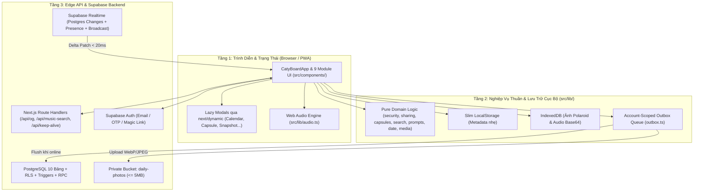
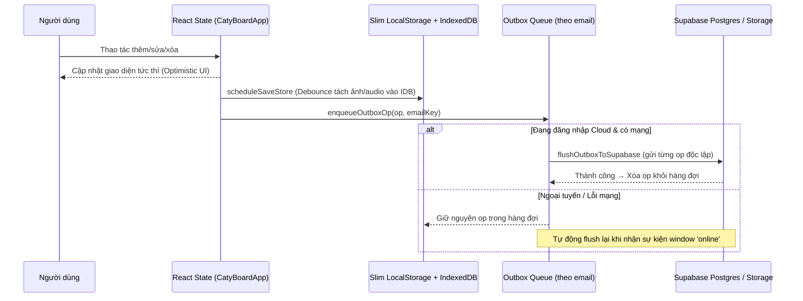

[← Mục lục Docs](../index.md)

# 02. Kiến Trúc Hệ Thống & Luồng Dữ Liệu

## 1. Kiến Trúc Tổng Thể 3 Tầng

Ứng dụng được xây dựng trên **Next.js 16 (App Router)** kết hợp mô hình **Local-First Client + Supabase Cloud Backend**, phân tách rõ ràng thành 3 tầng để đảm bảo khả năng kiểm thử độc lập và tốc độ phản hồi tức thì:

### Phân trách nhiệm giữa các lớp thư mục

1. **`src/app/` (Routing & Server Endpoints):**
   - `page.tsx`: Server Component sinh `metadata` động (bao gồm ảnh xem trước riêng khi có `?invite=...`) và gắn `CatyBoardApp`.
   - `widget/page.tsx`: Giao diện Mini-Widget tối giản cho MacBook/PC.
   - `api/og/route.tsx`: Render Dynamic Open Graph Image `1200×630` PNG bằng Takumi (`@takumi-rs/image-response`).
   - `api/music-search/route.ts`: Proxy tìm kiếm nhạc YouTube ngay trong ứng dụng.
   - `api/keep-alive/route.ts`: Endpoint nhận Vercel Cron mỗi 3 ngày để giữ Supabase Free Tier hoạt động liên tục.
2. **`src/components/` (Presentation Layer):**
   - `CatyBoardApp.tsx`: Shell điều phối phiên đăng nhập, hydration dữ liệu, Outbox flush, Realtime subscription và bố cục 4 tab.
   - Các thư mục con phân theo miền: `auth/`, `board/`, `calendar/`, `capsule/`, `cat/`, `desk/`, `music/`, `snapshot/`, `sync/`, `decor/`.
   - 9 modal ít mở lúc khởi động (`SearchCommandModal`, `ScrapbookCalendar`, `DailySnapshotModal`, `EndOfDayWizardModal`, `SyncSettingsModal`, `SharedBoardModal`, `CapsuleJarModal`, `CozyDeskModal`, `LetGoBonfireModal`) được tách chunk bằng `next/dynamic(..., { ssr: false })`.
3. **`src/lib/` (Pure Domain & Storage Layer):**
   - Toàn bộ hàm nghiệp vụ cốt lõi (`date.ts`, `media.ts`, `sharing.ts`, `security.ts`, `capsules.ts`, `search.ts`, `prompts.ts`, `storage.ts`, `outbox.ts`, `supabaseSync.ts`) không phụ thuộc React component, cho phép kiểm thử trực tiếp bằng `node --test`.

---

## 2. Luồng Ghi Dữ Liệu Local-First & Chống Mất Dữ Liệu

Khi người dùng thêm/sửa/xóa bất kỳ mục nào (ảnh, ghi chú, nhắc việc, chi tiêu, thu âm, bài nhạc):

> [!IMPORTANT]
> Cơ chế **Granular Outbox** chỉ gửi đúng thao tác thay đổi (`upsert_note`, `delete_reminder`, `upsert_photo`...) thay vì ghi đè toàn bộ JSON bảng, giúp 2 người cùng sửa các mục khác nhau trên cùng 1 bảng không bao giờ đè mất dữ liệu của nhau.

---

## 3. Luồng Đồng Bộ Thời Gian Thực (Realtime Delta Patching)

Trong chế độ 2 người, `subscribeBoardRealtime` mở một kênh WebSocket theo phòng `catyboard-room-<boardId>` gồm 3 luồng song song:

1. **Postgres Changes (Delta Patching):**
   - Lắng nghe thay đổi trên toàn bộ 10 bảng lọc theo `board_id = eq.<boardId>`.
   - Hàm `applyRealtimeDelta` (`src/lib/supabaseSync.ts`) vá trực tiếp các sự kiện `INSERT`/`UPDATE`/`DELETE` của `reminders`, `notes`, `finance_entries` và `day_photos` (nếu đã có URL cache) vào bộ nhớ trong **< 20ms** mà không cần truy vấn lại cả 10 bảng.
   - Chỉ kích hoạt `pullStoreFromSupabase` (debounce `350ms`) khi thay đổi liên quan đến thành viên (`board_members`, `board_invitations`), cấu hình bảng (`boards`), hoặc ảnh mới cần tạo Signed URL.
2. **Presence:** Theo dõi danh sách thành viên đang mở bảng để hiển thị chấm xanh *"Đang online cùng nhau"*.
3. **Broadcast:** Truyền sự kiện nhẹ tức thời không cần lưu DB gồm `heart_ping` (gửi trái tim `♡`) và `desk_treat` (đặt món quà nhỏ lên bệ cửa sổ mèo).

---

[← Trước: 01. Tổng quan sản phẩm](./01-tong-quan-san-pham.md) | [Tiếp theo: 03. Cơ sở dữ liệu & ERD →](./03-co-so-du-lieu-erd.md)
