[← Mục lục Docs](../index.md)

# 03. Thiết Kế Cơ Sở Dữ Liệu & Sơ Đồ ERD

## 1. Sơ Đồ Quan Hệ Thực Thể (ERD — 10 Bảng PostgreSQL)

Toàn bộ lược đồ cơ sở dữ liệu đám mây được định nghĩa idempotent trong [`supabase/schema.sql`](../../supabase/schema.sql), lấy `public.boards` làm trung tâm cách ly dữ liệu đa người dùng (Multi-Tenant Board Isolation):

```mermaid
erDiagram
    BOARDS ||--o{ BOARD_MEMBERS : "có tối đa 2 thành viên"
    BOARDS ||--o{ BOARD_INVITATIONS : "phát hành lời mời"
    BOARDS ||--o{ DAY_ENTRIES : "lưu check-in theo ngày"
    BOARDS ||--o{ DAY_PHOTOS : "chứa ảnh Polaroid"
    BOARDS ||--o{ NOTES : "chứa ghi chú, tâm thư, viên nang"
    BOARDS ||--o{ REMINDERS : "chứa lời nhắc & lặp"
    BOARDS ||--o{ FINANCE_ENTRIES : "chứa thu chi & tiết kiệm"
    BOARDS ||--o{ VOICE_MEMOS : "chứa băng thu âm <= 45s"
    BOARDS ||--o{ MUSIC_TRACKS : "chứa danh sách nhạc"

    BOARDS {
        uuid id PK
        uuid owner_id FK
        text board_title "Mặc định: Name"
        text cat_name "Mặc định: Mochi"
        text partner_cat_name "Mặc định: Latte"
        text cat_style "doodle|pixel|chibi|hybrid"
        text default_theme "sunlit|cozy-night"
        text board_texture "cork|linen|grid-paper|walnut"
        text font_style "rounded|handwriting"
        numeric monthly_budget
        jsonb saving_goal
        jsonb active_decor
        text journal_pin_hash
        jsonb active_track
        timestamptz updated_at
    }

    BOARD_MEMBERS {
        uuid board_id PK,FK
        uuid user_id PK,FK
        text role "owner|partner"
        text email
        text nickname "Mặc định: Him/Her"
        text heart_color "sky|sage|blush|cream"
        timestamptz joined_at
    }

    BOARD_INVITATIONS {
        uuid id PK
        uuid board_id FK
        uuid inviter_user_id FK
        text inviter_nickname
        text invitee_email "email hoặc open@invite.local"
        text invitee_nickname
        text invite_code UK "DIARY-XXXXXXXX"
        text status "pending|accepted|revoked"
        timestamptz created_at
    }

    DAY_ENTRIES {
        uuid id PK
        uuid board_id FK
        date entry_date "Unique(board_id, entry_date)"
        text mood
        text partner_mood
        text weather
        text song_title
        text daily_quote
        jsonb prompt_answers
        jsonb stickers
        timestamptz updated_at
    }

    DAY_PHOTOS {
        uuid id PK
        uuid board_id FK
        uuid author_id FK
        text author_role "owner|partner"
        date entry_date
        text storage_path
        text caption
        text washi_style "washi|frameColor"
        numeric rotation_deg
        boolean is_cover
        jsonb reactions
        jsonb comments
        timestamptz created_at
    }

    NOTES {
        uuid id PK
        uuid board_id FK
        uuid author_id FK
        text author_role
        date entry_date
        text kind "sticky|letter|time_capsule"
        text title
        text content "Plaintext hoặc E2EE AES-GCM"
        text paper_style "style hoặc capsule:..."
        boolean is_private
        date unlock_date
        boolean pinned
        timestamptz created_at
        timestamptz updated_at
    }

    REMINDERS {
        uuid id PK
        uuid board_id FK
        uuid author_id FK
        text author_role
        date entry_date
        text title
        text due_time
        boolean completed
        timestamptz completed_at
        text completed_by_role
        text recurrence "none|daily|weekly"
        text category
        timestamptz created_at
    }

    FINANCE_ENTRIES {
        uuid id PK
        uuid board_id FK
        uuid author_id FK
        text author_role
        date entry_date
        text type "expense|income|saving"
        numeric amount ">= 0"
        text category
        text mood_tag
        text note
        timestamptz created_at
    }

    VOICE_MEMOS {
        uuid id PK
        uuid board_id FK
        uuid author_id FK
        text author_role
        date entry_date
        text title
        text audio_data_url "<= 2.2MB, audio/*"
        int duration_sec "0..45"
        timestamptz created_at
    }

    MUSIC_TRACKS {
        uuid id PK
        uuid board_id FK
        uuid author_id FK
        text author_role
        text source "youtube|spotify"
        text url
        text embed_id
        boolean is_playlist
        text spotify_kind
        text title
        text artist_or_channel
        text vibe_tag
        boolean is_favorite
        timestamptz created_at
    }
```

---

## 2. Ràng Buộc Toàn Vẹn & Chỉ Mục Hiệu Năng

### Ràng buộc nghiệp vụ tại tầng DB (`CHECK` & `UNIQUE`)
- `day_entries`: Ràng buộc `unique (board_id, entry_date)` bảo đảm mỗi ngày chỉ có 1 bản ghi check-in tổng hợp cho mỗi bảng.
- `board_invitations`: `invite_code` là `unique` (6–32 ký tự), trạng thái chỉ nằm trong `('pending', 'accepted', 'revoked')`, `invitee_email` phải khớp định dạng email hợp lệ (bao gồm địa chỉ chuẩn `open@invite.local` cho Link mời mở).
- `voice_memos`: Chặn dữ liệu rác ngay tại DB bằng `char_length(audio_data_url) <= 2200000`, `audio_data_url ~* '^data:audio/(webm|mp4|mpeg|ogg|wav|x-m4a)'` và `duration_sec between 0 and 45`.
- `finance_entries`: `amount >= 0`, `type in ('expense', 'income', 'saving')`.

### Chỉ mục (Indexes)
Toàn bộ các bảng có dữ liệu tăng theo thời gian đều có chỉ mục ghép `(board_id, entry_date desc)` để truy vấn nhanh theo bảng và ngày:
- `idx_board_members_user (user_id)`
- `idx_board_invites_email (lower(invitee_email), status)`
- `idx_day_entries_board_date`, `idx_day_photos_board_date`, `idx_notes_board_date`, `idx_reminders_board_date`, `idx_finance_board_date`, `idx_voice_memos_board_date`.

---

## 3. Các Hàm SQL `SECURITY DEFINER` (RPC)

| Hàm RPC | Quyền gọi | Vai trò |
|---|---|---|
| `is_board_member(target_board_id)` | `authenticated` | Kiểm tra người dùng hiện tại có thuộc `board_members` không (tránh đệ quy RLS) |
| `is_board_owner(target_board_id)` | `authenticated` | Kiểm tra người dùng hiện tại có phải `owner_id` của bảng không |
| `is_dev_admin()` | `authenticated` | Kiểm tra tài khoản quản trị phát triển qua JWT email |
| `ensure_personal_board(p_default_nickname, p_board_title)` | `authenticated` | Trả về bảng hiện có của người dùng (ưu tiên bảng `partner` đã tham gia trước, rồi đến bảng `owner`), hoặc tạo mới bảng cá nhân |
| `get_my_pending_invitations()` | `authenticated` | Liệt kê các lời mời đang `pending` gửi đích danh tới email của người dùng |
| `preview_board_invitation(p_invite_code)` | `anon`, `authenticated` | Trả về metadata an toàn (tên bảng, biệt danh người mời, cờ `is_open_link`) cho màn hình đăng nhập/đăng ký khi bấm link mời |
| `accept_board_invitation(p_invite_code)` | `authenticated` | Xác thực mã mời (hỗ trợ cả Open Link lẫn email cố định), chặn tự mời chính mình, chặn quá 2 người, thêm vào `board_members` với vai `partner` và đánh dấu `accepted` |

---

## 4. Triggers Chống Giả Mạo & Storage Bucket

### 3 Triggers bảo vệ trường bất biến (`BEFORE UPDATE`)
1. `trg_prevent_board_tampering` trên `boards`: Chặn thay đổi `id` và `owner_id`.
2. `trg_prevent_member_role_tampering` trên `board_members`: Chỉ cho phép cập nhật `nickname` và `heart_color`; chặn tự nâng `role` thành `owner` hoặc đổi `user_id`/`board_id`.
3. `trg_*_ownership` trên `day_photos`, `notes`, `reminders`, `finance_entries`, `voice_memos`: Chặn chuyển quyền sở hữu `author_id` hoặc di chuyển bản ghi sang `board_id` khác.

### Storage Bucket riêng tư (`daily-photos`)
- `public = false`, giới hạn `file_size_limit = 5242880` (5MB), `allowed_mime_types = ['image/jpeg', 'image/png', 'image/webp']` (chặn tuyệt đối SVG/HTML/script).
- Quy ước đường dẫn: `<board_id>/<YYYY-MM-DD>/<photo_uuid>.<ext>`.
- Chính sách `storage.objects` kiểm tra thư mục đầu tiên phải là UUID hợp lệ và người dùng phải thỏa `public.is_board_member(...)`.

---

[← Trước: 02. Kiến trúc hệ thống](./02-kien-truc-he-thong.md) | [Tiếp theo: 04. Bảo mật & Quyền riêng tư →](./04-bao-mat-va-quyen-rieng-tu.md)
