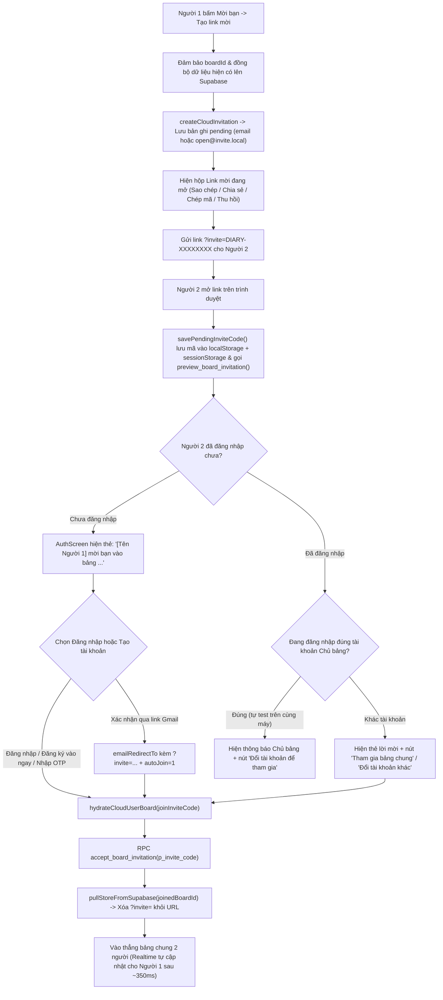

[← Mục lục Docs](../../index.md)

# F01 — Xác Thực Tài Khoản & Mời Người Thứ 2 Bằng Link

## 1. Mục Tiêu & Trải Nghiệm Người Dùng

Phân hệ xác thực và mời bạn giải quyết 2 mục tiêu song song:
- Cho phép người dùng đăng nhập/tạo tài khoản mượt mà trên mọi thiết bị (hỗ trợ cả vào ngay, xác nhận OTP 6 số, lẫn bấm link xác nhận trong Gmail, kèm quên mật khẩu).
- Cho phép Người 1 tạo **Link mời mở 1 chạm** (`https://dailyboard-ten.vercel.app/?invite=DIARY-XXXXXXXX`) mà **không cần biết trước email của Người 2** (vẫn hỗ trợ tùy chọn khóa email cố định). Khi Người 2 mở link, chỉ cần **Đăng nhập** hoặc **Tạo tài khoản mới** là vào thẳng bảng chung của cả hai.

---

## 2. Sơ Đồ Luồng Mời & Tham Gia Bảng Chung

---

## 3. Quy Tắc Nghiệp Vụ & Xử Lý Các Trường Hợp Biên

1. **Chống mất mã mời qua các bước xác thực:**
   - Ngay khi phát hiện `?invite=` trên URL, mã được chuẩn hóa bằng `extractInviteCodeFromInput` và lưu đồng thời vào `sessionStorage` + `localStorage`.
   - Khi đăng ký tài khoản mới, cờ `autoJoin = true` được bật và `emailRedirectTo` gắn kèm `/?invite=DIARY-...` để người dùng bấm *"Confirm your mail"* trong ứng dụng Gmail vẫn quay lại đúng bảng chung.
2. **Chống race condition với `onAuthStateChange`:**
   - Cờ `autoJoin` được ghi **trước** khi gọi `signInWithPassword` / `signUp` / `verifyOtp`, kèm biến khóa `inviteJoinInFlightRef` để tránh gọi `acceptCloudInvitation` trùng lặp hoặc tạo nhầm bảng solo trước khi kịp tham gia bảng chung.
3. **Hỗ trợ PWA cài ngoài Màn hình chính iPhone:**
   - Do PWA mở độc lập không nhận URL từ Zalo/Messenger, `SharedBoardModal` cung cấp sẵn ô **Tham gia bảng của người khác** cho phép dán nguyên đường link hoặc chỉ gõ mã `DIARY-XXXXXXXX`.
4. **Rời bảng chung an toàn (`handleRevertToSolo`):**
   - Nếu `owner` bấm *"Về bảng 1 người"*: xóa bản ghi `partner` trên `board_members`, thu hồi lời mời pending và giữ nguyên dữ liệu bảng của chủ bảng.
   - Nếu `partner` bấm *"Rời bảng chung"*: xóa dòng `partner` của chính mình trên `board_members`, đặt lại bộ nhớ cục bộ và gọi `hydrateCloudUserBoard` để quay về bảng cá nhân của riêng mình.

---

## 4. Các Tệp Mã Nguồn & Kiểm Thử Liên Quan

- **Giao diện đăng nhập & thẻ lời mời:** `src/components/auth/AuthScreen.tsx`
- **Hộp tạo link, chia sẻ & nhập mã tham gia:** `src/components/sync/SharedBoardModal.tsx`
- **Điều phối phiên, banner & rời bảng:** `src/components/CatyBoardApp.tsx`
- **Logic trích xuất mã & quản lý trạng thái:** `src/lib/sharing.ts`, `src/lib/supabaseSync.ts`
- **Hàm SQL trên Supabase:** `preview_board_invitation`, `accept_board_invitation`, `ensure_personal_board` trong `supabase/schema.sql`
- **Kiểm thử tự động:** `tests/core.test.ts` (test cases kiểm tra `extractInviteCodeFromInput`, `isOpenInviteEmail`, `inviteSecondPerson` với `activateDuoImmediately: false` và `revertToSoloBoard`).

---

[← Trước: 06. Quy chuẩn mã nguồn](../06-quy-chuan-ma-nguon.md) | [Tiếp theo: F02. Check-in, Mèo & Pomodoro →](./F02-checkin-meo-va-pomodoro.md)
