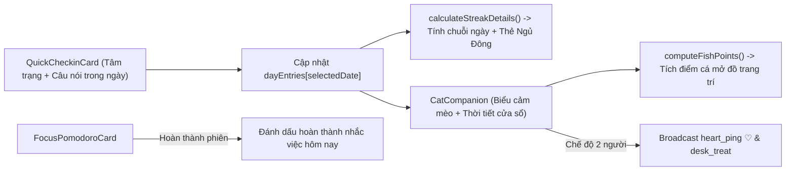

[← Mục lục Docs](../../index.md)

# F02 — Check-in 2 Giây, Mèo Đồng Hành & Đồng Hồ Pomodoro

## 1. Mục Tiêu & Trải Nghiệm Người Dùng

Tạo điểm chạm nhẹ nhàng nhất mỗi ngày: người dùng mở ứng dụng ra chỉ cần **2 giây** để chọn tâm trạng, ghi 1 dòng cảm nghĩ (Fridge Note) hoặc bật nhanh ô thêm ảnh/ghi chú/nhắc việc/thu âm, đồng thời tương tác với chú mèo Lofi bên khung cửa sổ và đồng hồ tập trung Pomodoro.

---

## 2. Sơ Đồ Tương Tác Hằng Ngày

---

## 3. Quy Tắc Nghiệp Vụ Cốt Lõi

1. **Chuỗi ngày & Thẻ Ngủ Đông (`calculateStreakDetails` — `src/lib/prompts.ts`):**
   - Một ngày được tính là "có hoạt động" khi người dùng có check-in (`checkedIn`), đăng ảnh, viết ghi chú, hoàn thành việc hoặc ghi chi tiêu.
   - Cứ mỗi **7 ngày hoạt động**, người dùng tích lũy được **1 Thẻ Ngủ Đông (`shieldsAvailable`)** tự động bắc cầu qua 1 ngày nghỉ để không bị gãy chuỗi đột ngột.
2. **Hệ thống Mèo Đồng Hành (`CatCompanion.tsx`):**
   - Chế độ 1 người hiển thị 1 chú mèo (`Mochi`), chế độ 2 người tự động hiển thị 2 chú mèo (`Mochi & Latte`) ngồi cạnh nhau bên khung cửa sổ đổi cảnh theo thời tiết (`sunny`, `rainy`, `cloudy`, `starry`...) và chủ đề sáng/tối.
   - Hỗ trợ 4 phong cách vẽ (`doodle`, `pixel`, `chibi`, `hybrid`), hệ thống điểm cá (`computeFishPoints`) mở khóa vật phẩm trang trí bàn (`activeDecor`), gửi trái tim `♡` và đặt món quà nhỏ (`desk_treat`) xuất hiện tức thì trên màn hình của người thứ 2.
3. **Đồng hồ tập trung Pomodoro (`FocusPomodoroCard.tsx`):**
   - Liên kết trực tiếp với danh sách nhắc việc chưa xong trong ngày (`pendingDayReminders`), cho phép chọn việc cần tập trung và đánh dấu hoàn thành ngay sau phiên làm việc.

---

## 4. Các Tệp Mã Nguồn & Kiểm Thử Liên Quan

- **Giao diện:** `src/components/board/QuickCheckinCard.tsx`, `src/components/cat/CatCompanion.tsx`, `src/components/cat/FocusPomodoroCard.tsx`
- **Logic thuần:** `src/lib/prompts.ts` (`calculateStreak`, `calculateStreakDetails`, `getDailyCatFortune`), `src/lib/search.ts` (`computeFishPoints`)
- **Kiểm thử tự động:** `tests/core.test.ts` (test tính chuỗi check-in nhanh, test cơ chế Thẻ Ngủ Đông bắc cầu qua 1 ngày nghỉ, test tính điểm cá).

---

[← Trước: F01. Xác thực & Mời Link 2 người](./F01-xac-thuc-va-moi-link-2-nguoi.md) | [Tiếp theo: F03. Album Polaroid & Lịch tháng →](./F03-album-polaroid-va-lich.md)
