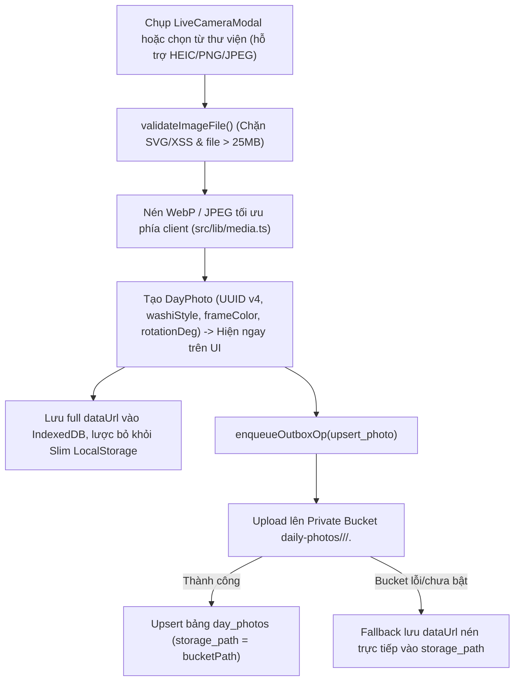

[← Mục lục Docs](../../index.md)

# F03 — Album Ảnh Polaroid 3D & Lịch Tháng Kỷ Niệm

## 1. Mục Tiêu & Trải Nghiệm Người Dùng

Biến mỗi bức ảnh chụp hằng ngày thành một **tấm Polaroid dán băng keo Washi Tape** có thể xoay góc, đổi màu khung, viết chú thích nét tay, **lật 3D ra mặt sau để nghe ghi âm kỷ niệm**, thả biểu cảm / bình luận giữa 2 người và ôn lại qua Lịch Tháng Scrapbook cùng thẻ *Ký ức ngày cũ* (Throwback).

---

## 2. Sơ Đồ Xử Lý Ảnh Từ Camera / Thư Viện Lên Bảng & Cloud

---

## 3. Quy Tắc Nghiệp Vụ & Tối Ưu Biên

1. **Chống giật khi gõ chú thích Polaroid:** Ô nhập chú thích (`PolaroidCaptionInput` trong `PolaroidGallery.tsx`) sử dụng local state + debounce trước khi gọi `onUpdatePhoto`, tránh lưu lại toàn bộ store theo từng phím bấm.
2. **Polaroid 3D Flip & Ghi âm mặt sau:** Mỗi tấm Polaroid có thể lật 3D sang mặt sau để ghi âm/nghe lại đoạn lời nhắn gắn liền với khoảnh khắc đó (lưu qua bình luận đặc biệt `__polaroid_back_voice__`, được tách an toàn vào IndexedDB bởi `stripHeavyMediaForLocalStorage`).
3. **Đóng gói `washiStyle` + `frameColor` tương thích ngược:** Khi đồng bộ lên cột `washi_style` trên Postgres, hàm `encodeWashiAndFrame` / `decodeWashiAndFrame` ghép dạng `<washi>|<frameColor>` để không cần phá vỡ schema cũ.
4. **Lịch Tháng & Ký ức ngày cũ:**
   - `ScrapbookCalendar.tsx` hiển thị lưới tháng (`getMonthMatrix`) với ảnh bìa thu nhỏ (`isCover`) và chấm trạng thái từng ngày.
   - `pickThrowbackPhoto` (`src/lib/search.ts`) tự động chọn 1 ảnh kỷ niệm từ các ngày trước đó để gợi nhớ trên tab *Hôm nay*.

---

## 4. Các Tệp Mã Nguồn & Kiểm Thử Liên Quan

- **Giao diện:** `src/components/board/PolaroidGallery.tsx`, `src/components/board/LiveCameraModal.tsx`, `src/components/calendar/ScrapbookCalendar.tsx`, `src/components/calendar/MonthlyWrappedModal.tsx`
- **Logic & Lưu trữ:** `src/lib/media.ts`, `src/lib/security.ts` (`validateImageFile`), `src/lib/storage.ts`, `src/lib/supabaseSync.ts`, `src/lib/search.ts` (`pickThrowbackPhoto`)
- **Kiểm thử tự động:** `tests/core.test.ts` (kiểm tra `validateImageFile` với HEIC/SVG/>25MB, `pickThrowbackPhoto`, và bảo toàn ảnh + ghi âm mặt sau Polaroid qua `stripHeavyMediaForLocalStorage` / `mergeStoresPreservingMedia`).

---

[← Trước: F02. Check-in, Mèo & Pomodoro](./F02-checkin-meo-va-pomodoro.md) | [Tiếp theo: F04. Hũ Viên Nang & Lửa Trại Let-Go →](./F04-hu-vien-nang-va-lua-trai.md)
