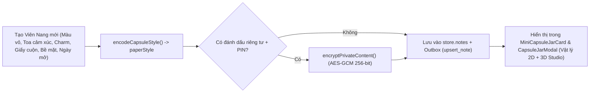

[← Mục lục Docs](../../index.md)

# F04 — Hũ Viên Nang Cảm Xúc 2D/3D & Lửa Trại Let-Go

## 1. Mục Tiêu & Trải Nghiệm Người Dùng

Đây là không gian chăm sóc cảm xúc đặc trưng của **Nhật Kí (`DailyBoard`)**, gồm 2 trải nghiệm bổ trợ nhau:
- **Hũ Viên Nang (`CapsuleJarModal` & `MiniCapsuleJarCard`):** Nơi thả những thông điệp động viên bản thân hoặc gửi cho người kia theo từng "toa cảm xúc" (khi buồn, khi nhớ, khi cần động lực, hoặc niêm phong gửi tương lai theo ngày mở `unlockDate`), hiển thị dưới dạng hũ thủy tinh tương tác vật lý 2D kèm xem trước viên nang 3D nhiều lớp chất liệu.
- **Lửa Trại Let-Go (`LetGoBonfireModal`):** Nơi viết ra những điều nặng lòng muốn buông bỏ rồi "đốt" tan thành tro tàn **không lưu bất kỳ dấu vết nào xuống máy hay cloud**, kết hợp hướng dẫn nhịp thở 4-7-8.

---

## 2. Cấu Trúc Mã Hóa Metadata Viên Nang

Thay vì tạo bảng phụ cồng kềnh, mỗi Viên Nang được lưu thống nhất trong bảng `notes` với `kind = 'time_capsule'` và mã hóa toàn bộ thuộc tính ngoại hình vào chuỗi `paperStyle` qua `src/lib/capsules.ts`:

```text
capsule:<colorId>:<prescriptionId>:<openedCount>:<charmId>:<scrollSkinId>:<finishId>
```

Ví dụ: `capsule:clear-firefly:sad:3:origami-star:sakura-pink:candy-stripe`



---

## 3. Quy Tắc Nghiệp Vụ & Bảo Mật Nội Dung Niêm Phong

1. **Tách biệt khỏi Ghi chú thường:** Hàm `isPureCapsuleNote` bảo đảm các viên nang sống trong Hũ Viên Nang không làm rối danh sách ghi chú hằng ngày trên tab *Hôm nay*.
2. **Bảo vệ nội dung trước ngày mở (`unlockDate`):**
   - Viên nang có `unlockDate` ở tương lai ở trạng thái niêm phong — giao diện chỉ hiện tiêu đề và ngày mở.
   - Bộ tìm kiếm toàn cục `searchAcrossBoard` (`src/lib/search.ts`) **tuyệt đối không lập chỉ mục hay trả về nội dung** của viên nang chưa tới ngày mở (chỉ cho phép tìm theo tiêu đề kèm nhãn *"Niêm phong"*).
3. **Tương thích ngược định dạng cũ:** `parseCapsuleStyle` hỗ trợ mượt cả chuỗi 4 đoạn cũ (`capsule:color:prescription:count`) lẫn 6–7 đoạn mới (tự gán mặc định `charmId`, `scrollSkinId`, `finishId`).
4. **Zero-Trace Let-Go Bonfire:** Nội dung gõ trong `LetGoBonfireModal` chỉ tồn tại trong React state tạm thời và bị xóa sạch ngay khi hoàn tất hoạt ảnh đốt giấy — không gọi `saveStore` hay `queueSync`.

---

## 4. Các Tệp Mã Nguồn & Kiểm Thử Liên Quan

- **Giao diện:** `src/components/capsule/MiniCapsuleJarCard.tsx`, `src/components/capsule/CapsuleJarModal.tsx`, `src/components/capsule/CapsuleGraphic.tsx`, `src/components/capsule/LetGoBonfireModal.tsx`
- **Logic thuần:** `src/lib/capsules.ts` (`encodeCapsuleStyle`, `parseCapsuleStyle`, `extractCapsulesFromNotes`, `isCapsuleNote`, `isPureCapsuleNote`)
- **Kiểm thử tự động:** `tests/core.test.ts` (test encode/decode 7 đoạn, tương thích ngược 4 đoạn và kiểm chứng không rò rỉ nội dung viên nang niêm phong qua `searchAcrossBoard`).

---

[← Trước: F03. Album Polaroid & Lịch tháng](./F03-album-polaroid-va-lich.md) | [Tiếp theo: F05. Sổ Tay, Nhắc Việc & Tài Chính →](./F05-so-tay-nhac-viec-va-tai-chinh.md)
