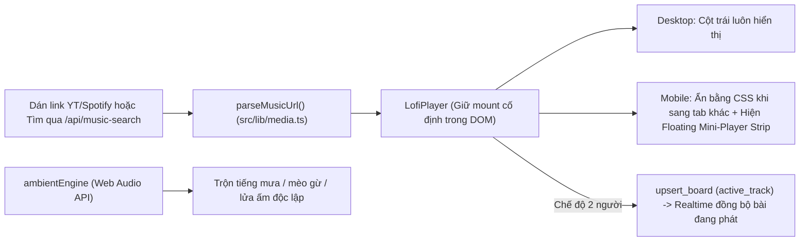

[← Mục lục Docs](../../index.md)

# F06 — Phòng Nhạc Lofi, Tìm Nhạc Trong App & Âm Thanh Nền

## 1. Mục Tiêu & Trải Nghiệm Người Dùng

Tạo một góc nghe nhạc không bị gián đoạn xuyên suốt quá trình viết nhật ký:
- Dán trực tiếp link **YouTube** (video, livestream, link rút gọn `youtu.be`, playlist) hoặc **Spotify** (track, album, playlist kể cả đường dẫn có vùng ngôn ngữ `/intl-vi/`).
- Tìm kiếm bài hát/đài Lofi ngay bên trong ứng dụng hoặc chọn từ danh sách đài Lofi tuyển chọn sẵn.
- Trộn thêm âm thanh không gian (**tiếng mưa rơi, tiếng mèo gừ *purr*, lửa ấm**) bằng Web Audio API mà không cần tải file MP3 nặng.
- **Nghe cùng nhau ở chế độ 2 người:** Khi chọn bài hát, `syncedTrack` được cập nhật vào cột `boards.active_track` để đồng bộ sang màn hình người còn lại.

---

## 2. Kiến Trúc Phát Nhạc Liên Tục (Zero-Interruption Audio)

> [!TIP]
> Trên thiết bị di động, `aside` chứa `LofiPlayer` được ẩn bằng lớp CSS (`hidden lg:block`) thay vì unmount khỏi React tree. Nhờ đó iframe YouTube/Spotify vẫn tiếp tục phát mượt khi người dùng chuyển qua tab *Hôm nay*, *Kỷ niệm* hay *Sổ tay*, đồng thời có thanh Mini-Player nổi ở đáy để chuyển bài tiếp hoặc dừng nhanh.

---

## 3. Quy Tắc Nghiệp Vụ & Bảo Mật

1. **Chuẩn hóa URL an toàn:** `parseMusicUrl` chỉ sinh URL nhúng từ tên miền tin cậy (`youtube.com`, `youtube-nocookie.com`, `open.spotify.com`) khớp chặt với `frame-src` trong `Content-Security-Policy` của `next.config.ts`.
2. **Ghim bài hát của ngày:** Nút ghim bài hát lưu `songTitle`, `songArtist`, `songSource`, `songUrl` vào `day_entries` của ngày đang chọn để hiện trên thẻ xuất PNG cuối ngày.
3. **Spotify OAuth tùy chọn:** Dán link Spotify chạy ngay không cần cấu hình; nếu muốn duyệt playlist cá nhân có thể cung cấp thêm `NEXT_PUBLIC_SPOTIFY_CLIENT_ID`.

---

## 4. Các Tệp Mã Nguồn & Kiểm Thử Liên Quan

- **Giao diện:** `src/components/music/LofiPlayer.tsx`, Mini-Player trong `src/components/CatyBoardApp.tsx`
- **API & Logic:** `src/app/api/music-search/route.ts`, `src/lib/media.ts` (`parseMusicUrl`), `src/lib/curatedTracks.ts`, `src/lib/audio.ts` (`ambientEngine`)
- **Kiểm thử tự động:** `tests/core.test.ts` (test `parseMusicUrl` cho YouTube watch/short/playlist, Spotify localized playlist và từ chối link rác).

---

[← Trước: F05. Sổ Tay, Nhắc Việc & Tài Chính](./F05-so-tay-nhac-viec-va-tai-chinh.md) | [Tiếp theo: F07. Đồng Bộ Local-First & Outbox →](./F07-dong-bo-local-first-va-outbox.md)
