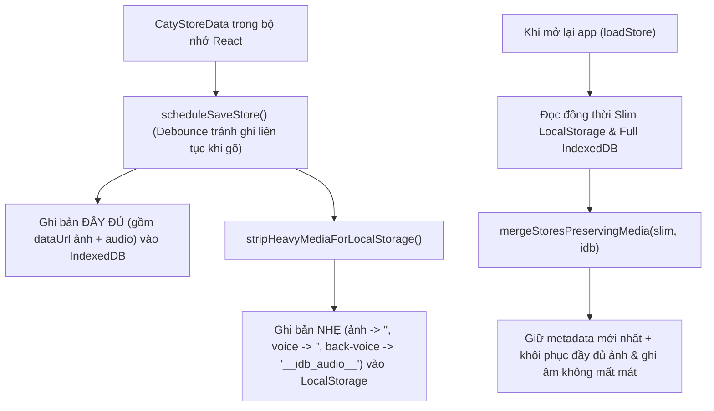

[← Mục lục Docs](../../index.md)

# F07 — Đồng Bộ Local-First, Tách Media IndexedDB & Hàng Đợi Outbox

## 1. Mục Tiêu & Bài Toán Kỹ Thuật

Trình duyệt di động (đặc biệt là Safari trên iOS) giới hạn dung lượng `localStorage` ở mức **~5MB** và chạy đồng bộ trên luồng chính. Nếu lưu trực tiếp ảnh Polaroid base64 và băng thu âm vào `localStorage`, ứng dụng sẽ nhanh chóng báo lỗi `QuotaExceededError` hoặc bị khựng mỗi khi gõ chữ.

Phân hệ này giải quyết triệt để 3 bài toán:
1. **Không bao giờ tràn `localStorage`:** Tách media nặng sang **IndexedDB**, giữ bản chụp metadata siêu nhẹ trong `localStorage`.
2. **Không bao giờ mất dữ liệu khi ngoại tuyến:** Mọi thao tác sửa đổi được xếp vào **Outbox Queue theo tài khoản** và tự động đẩy bù khi có mạng.
3. **Không ghi đè chéo dữ liệu giữa 2 người:** Đồng bộ từng mục nhỏ (granular ops) kết hợp vá Realtime Delta.

---

## 2. Kiến Trúc 2 Tầng Lưu Trữ Cục Bộ (`src/lib/storage.ts`)

---

## 3. Cơ Chế Hàng Đợi Outbox & Bảo Vệ Dữ Liệu Khi Pull

1. **Account-Scoped Outbox (`src/lib/outbox.ts`):**
   - Mỗi tài khoản (`emailKey`) có hàng đợi `OutboxOp[]` riêng gồm 15 loại thao tác chi tiết (`upsert_board`, `upsert_day`, `upsert_photo`, `delete_photo`, `upsert_note`, `delete_note`, `upsert_reminder`, `delete_reminder`, `upsert_finance`, `delete_finance`, `upsert_voice`, `delete_voice`, `upsert_track`, `delete_track`).
   - Khi `flushOutboxToSupabase` chạy: từng op được thực thi độc lập; op nào thành công bị gỡ khỏi hàng đợi, op nào lỗi mạng được giữ lại để tự thử lại khi sự kiện `window.addEventListener('online')` kích hoạt.
2. **Chống mất dữ liệu chưa đồng bộ khi `pullStoreFromSupabase`:**
   - Khi kéo dữ liệu từ Supabase về, `pullStoreFromSupabase` đọc danh sách op đang còn nằm trong Outbox:
     - Các mục đang chờ `upsert_*` chưa kịp lên cloud vẫn được giữ lại, không bị dữ liệu cũ trên server xóa mất.
     - Các ảnh đang chờ `delete_photo` không bị hiện lại từ server.
3. **Chuyển bảng an toàn trên thiết bị phụ:**
   - Khi `hydrateCloudUserBoard` phát hiện `ensureCloudBoard` trả về một `boardId` mới (ví dụ người dùng vừa tham gia bảng chung 2 người trên thiết bị khác), hệ thống **không** đẩy nhầm Outbox của bảng solo cũ sang bảng chung mới.

---

## 4. Các Tệp Mã Nguồn & Kiểm Thử Liên Quan

- **Lưu trữ & Outbox:** `src/lib/storage.ts`, `src/lib/outbox.ts`, `src/lib/supabaseSync.ts`
- **Điều phối đồng bộ:** `src/components/CatyBoardApp.tsx` (`flushCloudQueue`, `queueSync`, `hydrateCloudUserBoard`, `handleSyncNow`)
- **Kiểm thử tự động:** `tests/core.test.ts` (test `stripHeavyMediaForLocalStorage` và `mergeStoresPreservingMedia` bảo toàn ảnh, ghi âm mặt sau Polaroid và băng thu âm khi sửa metadata trước khi IDB hoàn tất).

---

[← Trước: F06. Phòng Nhạc Lofi & Âm Thanh](./F06-phong-nhac-lofi-va-am-thanh.md) | [Tiếp theo: F08. Xuất Thẻ Ngày & OG Image →](./F08-xuat-the-ngay-va-og-image.md)
