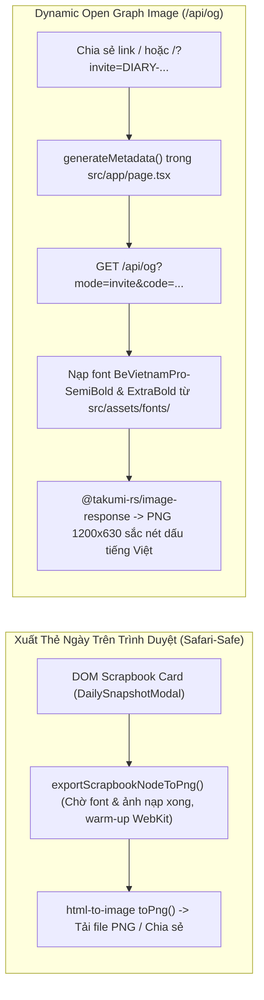

[← Mục lục Docs](../../index.md)

# F08 — Xuất Thẻ Ngày PNG, Tổng Kết Cuối Ngày & Dynamic OG Image (Takumi)

## 1. Mục Tiêu & Trải Nghiệm Người Dùng

Giúp người dùng biến một ngày bình thường thành một **tấm thiệp kỷ niệm có thể lưu hoặc chia sẻ**:
- **Chốt ngày trong 15 giây (`EndOfDayWizardModal`):** Hướng dẫn nhanh qua các bước chọn tâm trạng, thêm ảnh hoặc khoản chi, rồi chuyển thẳng sang xuất thẻ ngày.
- **Xuất Thẻ Ngày PNG (`DailySnapshotModal`):** Đóng gói ảnh Polaroid, câu nói trong ngày, sticker, tâm trạng, số việc hoàn thành và bài hát ghim thành một tấm ảnh PNG sắc nét (tương thích tốt cả Chrome lẫn Safari/iOS).
- **Dynamic Open Graph Image (`1200×630` PNG qua Takumi):** Khi gửi link ứng dụng hoặc gửi **link mời 2 người (`?invite=DIARY-...`)** lên Zalo, Messenger, Discord, iMessage, hệ thống tự sinh ảnh xem trước sắc nét đúng tiếng Việt.

---

## 2. Luồng Xuất Ảnh PNG & Render OG Image

---

## 3. Điểm Kỹ Thuật Nổi Bật

1. **Khắc phục lỗi ảnh trắng trên Safari/WebKit (`src/lib/snapshotExport.ts`):**
   - `html-to-image` trên Safari thường bị lỗi bỏ sót ảnh hoặc font ở lần gọi đầu tiên do cơ chế vẽ `foreignObject` SVG của WebKit.
   - Hàm `exportScrapbookNodeToPng` thực hiện chờ `document.fonts.ready`, đảm bảo các thẻ `` đã decode xong và thực hiện bước warm-up trước khi xuất bản PNG cuối cùng.
2. **Takumi Native Rust Renderer + Font Tiếng Việt cục bộ (`src/app/api/og/route.tsx`):**
   - Khai báo `serverExternalPackages: ['@takumi-rs/core', '@takumi-rs/image-response', 'takumi-js']` trong `next.config.ts` để Next.js nạp binary native sạch khi build/deploy trên Vercel.
   - Đóng gói sẵn `BeVietnamPro-SemiBold.ttf` và `BeVietnamPro-ExtraBold.ttf` ngay trong `src/assets/fonts/` để không phụ thuộc mạng ngoài và không bao giờ bị lỗi mất dấu tiếng Việt (`ẬọảĐườộậ`).
   - Hỗ trợ 2 chế độ ảnh tự động: ảnh mặc định giới thiệu ứng dụng và ảnh riêng cho **Lời mời vào Bảng Chung 2 Người** khi đường dẫn có tham số `?invite=`.

---

## 4. Các Tệp Mã Nguồn Liên Quan

- **Xuất thẻ ngày & Chốt ngày:** `src/components/snapshot/DailySnapshotModal.tsx`, `src/components/snapshot/EndOfDayWizardModal.tsx`, `src/lib/snapshotExport.ts`
- **Dynamic OG Image & Metadata:** `src/app/api/og/route.tsx`, `src/app/layout.tsx`, `src/app/page.tsx`, `src/assets/fonts/BeVietnamPro-*.ttf`, `next.config.ts`

---

[← Trước: F07. Đồng Bộ Local-First & Outbox](./F07-dong-bo-local-first-va-outbox.md) | [Tiếp theo: F09. PWA, Mini-Widget & Cozy Desk →](./F09-pwa-widget-va-cozy-desk.md)
